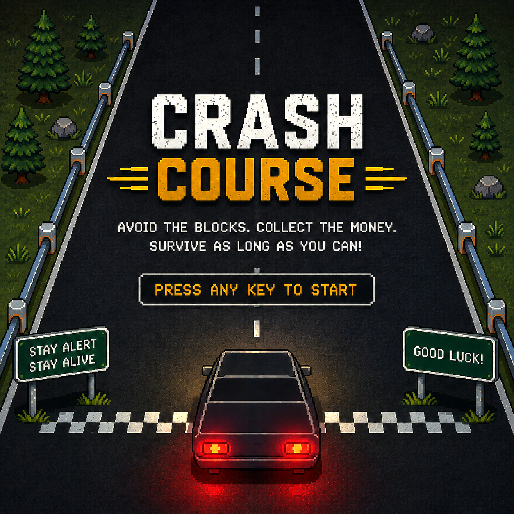

# 🚗 Crash Course

**Crash Course** is a 2D car dodging game developed using Python and Pygame. The objective is simple: control your car, avoid incoming obstacles, survive as long as possible, and achieve the highest score.

## 🎮 Features

- 2D car dodging gameplay.
- Smooth car movement and controls.
- Randomly spawning obstacles.
- Collision detection.
- Score tracking.
- Crash and restart functionality.
- Background music and sound effects.
- Browser compatibility through Pygbag.

## 🕹️ Controls

| Key | Action |
|---|---|
| ⬅️ Left Arrow | Move Left |
| ➡️ Right Arrow | Move Right |

## 🛠️ Technologies Used

- Python
- Pygame

